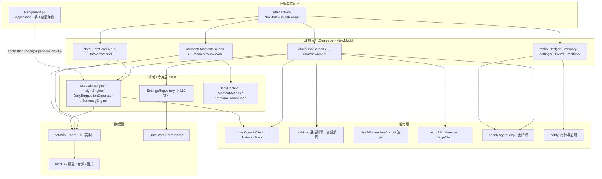
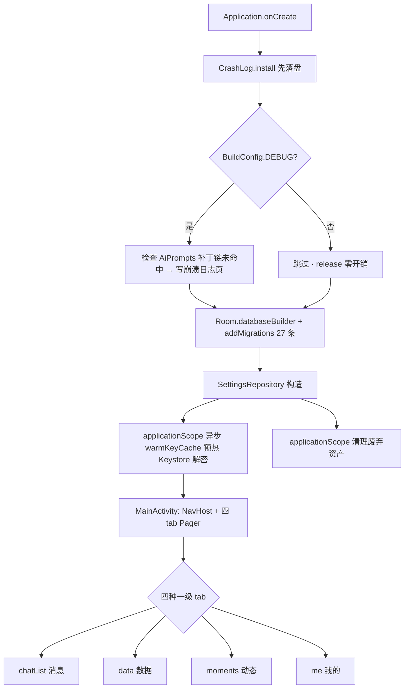
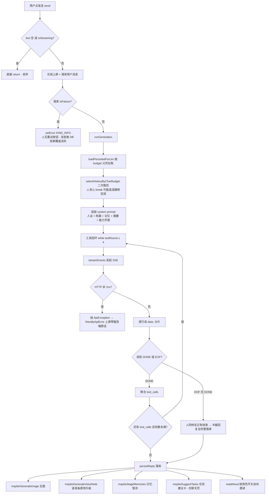
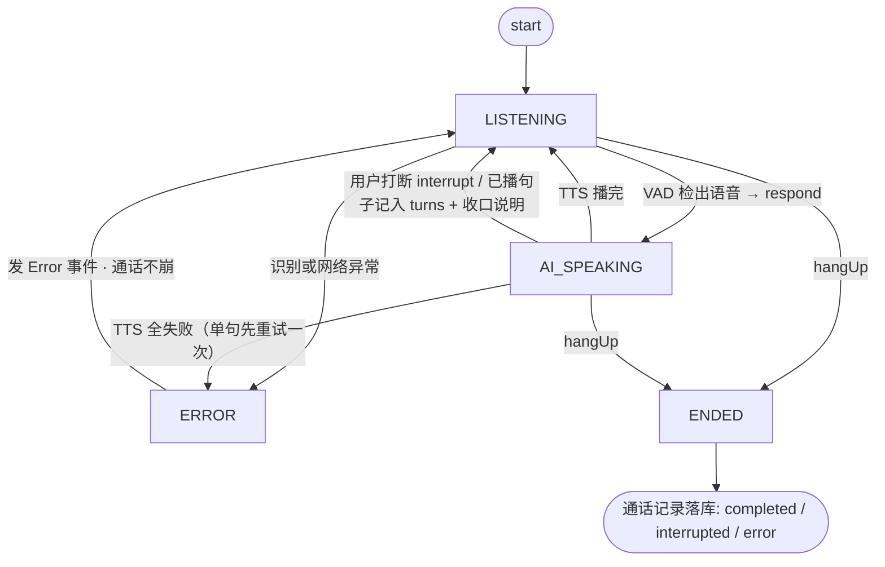
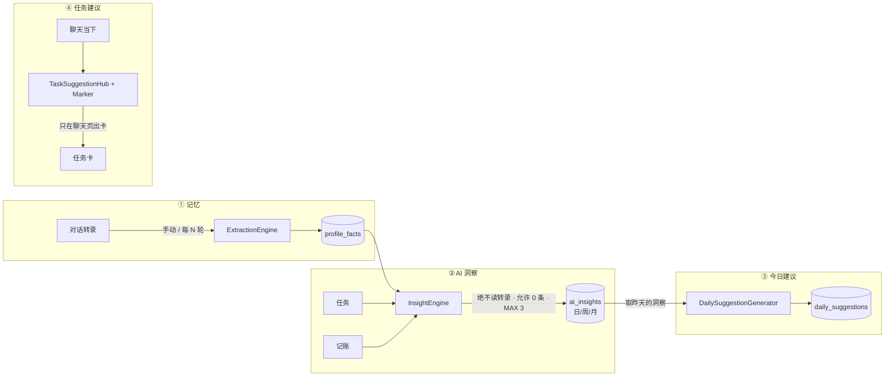

# 梦欢 · 代码审查报告

- **审查时间**：2026-10-11
- **审查基线**：当前工作树（`versionName = 0.96.0` / `versionCode = 185`，`app/build.gradle.kts`）
- **审查范围**：`app/src/main/java/com/menghuan/app/**`（201 个 Kotlin 文件 / 约 5.7 万行）+ 构建配置 + `AndroidManifest.xml` + `res/xml/` 安全配置
- **方法**：分模块精读源码 + 交叉验证调用点；所有结论均带 `文件:行`，未在源码中确认的推断一律标注「需确认」
- **未覆盖**：真机行为、性能实测、`cubism/` 第三方 SDK 源码内部、`_sdkfull/` 与本项目无关

---

## 一、项目总体评价

### 1.1 项目用途

「梦欢」是一款**纯单机、用户自带 API 的 Android AI 伴侣 App**。核心能力：

| 能力域 | 说明 |
|---|---|
| 角色对话 | 多角色（persona）多会话，OpenAI 兼容 SSE 流式对话，支持工具调用（MCP）|
| 语音栈 | 离线 SenseVoice 识别（sherpa-onnx）/ 在线 ASR 二选一；三家 TTS 可切；音色克隆 |
| 语音通话 | 端侧 ASR + 逐句 TTS 的"伪实时"通话，形象可为 Live2D 或本地视频 |
| Live2D | Cubism 5 模型加载、动作/表情/互动区域、舞台背景（图片/视频）|
| 数据页 | 本周回顾 / 今日建议 / 记账本 / 任务 / 角色空间 / AI 洞察 |
| 动态 | 类朋友圈，含 AI 主动发帖与互动（仅主动关心链）|
| AI 记忆 | 对话提炼 → `profile_facts`，含向量语义召回、生命周期升降级 |
| 手机 Agent | 无障碍服务驱动的自动操作（点按/输入/滑动）|
| 提醒 | 任务提醒、定时消息、定时电话、主动关心、每日建议/洞察闹钟 |

设计取向非常明确：**数据只存本机**、**不猜任何服务商域名**、**自己填端点**、**AI 提到的内容必须来自宿主喂的料**。

### 1.2 技术栈

| 层 | 选型 | 版本 |
|---|---|---|
| 语言 / 构建 | Kotlin + Gradle DSL（KSP）| compileSdk 35 / minSdk 26 / targetSdk 35 / JDK 17 |
| UI | Jetpack Compose + Material3 | BOM 2024.12.01，material3-window-size-class |
| 导航 | Navigation-Compose | 2.8.5 |
| 本地库 | Room | 2.6.1（18 实体 / version 28 / 27 条迁移）|
| 配置 | DataStore-Preferences | 1.1.1（约 110 个偏好键）|
| 网络 | OkHttp（手写 SSE 解析）| 4.12.0 |
| 语音识别 | sherpa-onnx（离线 SenseVoice）| 1.13.8（本地 AAR，**仅 arm64-v8a**）|
| 语音合成 | 硅基流动 CosyVoice2 / 小米 MiMo / 自定义 OpenAI 兼容 | 三家各自实现 |
| 渲染 | Live2D Cubism | 5-r.5（开源 Framework 源码 + 闭源 Core AAR）|
| 视频 | Media3 ExoPlayer（**不引 media3-ui**）| 1.9.0（钉死，1.10+ 需 compileSdk 36）|
| 桌面组件 | Glance AppWidget | 1.1.1 |
| 测试 | Robolectric + Roborazzi 截图 + MockWebServer | 4.14.1 / 1.26.0 / 4.12.0（66 文件 / 734 个 `@Test`）|

### 1.3 架构分层

**单 module（`app`）+ 一个附加源码目录（`cubism/`）**，没有多 module 拆分，也没有引入 DI 框架——全局单例在 `MenghuanApp`（Application）里手工装配（`MenghuanApp.kt:36-140`），ViewModel 由 `viewModelFactory` 手工构造（如 `ChatViewModel.kt:2270`）。



**关键架构事实（影响后文多处结论）**：`MenghuanApp.kt:39` 定义了 `val applicationScope = CoroutineScope(SupervisorJob() + Dispatchers.IO)`，`ChatViewModel.generationScope` 直接复用它（`ChatViewModel.kt:453`）。也就是说**整条生成管线（`reply()`、`_uiState.update`、自动朗读）跑在 IO 线程，而 UI 收集器在 Main 线程**。同时这条 scope **没有 `CoroutineExceptionHandler`**。

### 1.4 规模与健康度速览

| 指标 | 数值 | 评价 |
|---|---|---|
| 主源码 | 201 文件 / 57k 行 | 单 module，体量可观 |
| 最大文件 | `ui/chat/ChatScreen.kt` 3193 行 | 偏大 |
| 最大类 | `SettingsRepository.kt` 2450 行 / ~110 键 | **God Object** |
| 迁移 | 27 条，1→28 连续，**无**破坏性迁移 | ✅ 优秀 |
| 主线程 DAO | 0 处（全 suspend/Flow） | ✅ 优秀 |
| `runCatching`（data/） | 260 处 | ⚠️ 吞异常面大 |
| `Toast.makeText` / `Snackbar` | 21 / **0** | ⚠️ 反馈体系割裂 |
| 测试 | 66 文件 / 734 用例，含截图回归 | ✅ 远超同类个人项目 |
| `GlobalScope` / `runBlocking` | 0 / 1（有意为之）| ✅ |

---

## 二、优点与缺点清单

### 2.1 设计合理之处

| # | 优点 | 位置 | 说明 |
|---|---|---|---|
| A1 | **迁移纪律严格** | `AppDatabase.kt:782-1280`、`MenghuanApp.kt:98-128` | 27 条迁移 1→28 无缺口；**全项目无 `fallbackToDestructiveMigration`**，杜绝"升级即清库" |
| A2 | **无主线程数据库访问** | `data/db/AppDatabase.kt` 全部 DAO | 逐条核验：所有方法均为 `suspend` 或返回 `Flow`，不存在同步阻塞式 DAO |
| A3 | **密钥用系统 Keystore，非自写密码学** | `data/ApiKeyCipher.kt:33-72` | AES/GCM/NoPadding，密钥别名 `menghuan_api_key` 由 `AndroidKeyStore` 生成、**不可导出**，落盘 `Base64(IV+密文)` |
| A4 | **备份面收口干净** | `AndroidManifest.xml:42`、`res/xml/data_extraction_rules.xml:4-17` | `allowBackup=false` + cloud-backup/device-transfer 全目录 exclude；`DataBackup.kt:55-141` 导出 JSON 只含 5 类业务数据，**不含任何密钥** |
| A5 | **LLM 错误绝不混进回复流** | `llm/OpenAiClient.kt:210-212` | 非 2xx 一律抛 `ApiException`；注释明确"否则会被当作 AI 回复落库" |
| A6 | **工具调用有界 + 结果不可信包裹** | `ChatViewModel.kt:1388/2257`、`mcp/McpManager.kt:150-171` | `MAX_TOOL_ROUNDS = 4` 防死循环；工具结果 `wrapUntrusted` + 8000 字截断，抗提示注入 |
| A7 | **MCP 无任意命令执行面** | `mcp/McpClient.kt:50` | 明确"只支持远程 HTTP，不支持本地 stdio"，且 UI 同样明示 |
| A8 | **Agent 循环有界** | `agent/AgentLoop.kt:42/76-80` | `maxSteps = 15`；连续两次相同动作即判卡住停止；节点遍历上限 600 / 单屏 40 |
| A9 | **通知重启恢复完整** | `notify/TaskReminderReceiver.kt:303-355` | `BootReceiver` 处理 `BOOT_COMPLETED` + `MY_PACKAGE_REPLACED`，重排全部 7 类闹钟 |
| A10 | **Android 14+ 适配正确** | `data/AiCall.kt:271-285` | 用 `canUseFullScreenIntent()` 判断，拿不到就降级为高优先级通知 + 铃声 |
| A11 | **通话链降级兜底较全** | `realtime/PipelineVoiceCallEngine.kt:467-547` | 网络断 / TTS 失败（重试一次 + 字幕兜底）/ 用户打断，三条路径都有兜底与"收口说明" |
| A12 | **工程注释质量罕见** | 全项目 | 把"为什么这么做"和踩过的坑写在代码里（如 `build.gradle.kts` 里 media3 1.10 的 `minCompileSdk=36` 坑），极大降低后续返工 |

### 2.2 问题清单

#### A. 架构与可维护性

| # | 问题 | 位置 | 影响 | 优先级 |
|---|---|---|---|---|
| B1 | **God Object**：单类 2450 行、约 110 个偏好键，横向承担十余个不相关领域（对话/生图/TTS 三家/搜索/ASR/Embedding/MCP/外观/用量/主动关心/通话规则…）| `data/SettingsRepository.kt:76-2450`（`PreferencesKey(` 共 **137** 处）| 编译期耦合高、单测需构造巨类、任意改动都可能触碰无关键 | 中 |
| B2 | **`AiPrompts` 265 条链式 `manualPatch`**，锚点是**上游补丁的产物**（序依赖）；失配时**静默落空**，且自检只在 debug 生效 | `data/AiPrompts.kt:131-2370`（`grep -c .manualPatch(` = **265**）| 删/调序任一上游补丁 → 下游助手手册永久缺段，release 包**零运行时报错**，极难定位 | 中高 |
| B3 | **ChatViewModel 职责超载**：2289 行，承担至少 14 个子系统；`reply()` 单函数近 400 行 | `ui/chat/ChatViewModel.kt:1091-1492` | 任一改动影响面不可控 | 中 |
| B4 | **实体与 DAO/迁移分离 + 单文件堆积**：18 实体在 `model/`，17 个 DAO 与 27 条迁移全挤在一个文件 | `data/db/AppDatabase.kt`（1283 行）| 跨文件对照成本高 | 低 |
| B5 | **无 DI 框架**，全局单例手工装配 | `MenghuanApp.kt:36-140` | 单测需自建装配；但项目规模下尚可接受 | 低 |

#### B. 并发与正确性（**高危集中区**）

| # | 问题 | 位置 | 影响 | 优先级 |
|---|---|---|---|---|
| **B6** | **AgentLoop 的网络异常完全未捕获** | `agent/AgentLoop.kt:90-106`（`requestAction` 裸调 `collectReply`）+ `:213-243`（`AgentRunner.start` 的 `scope.launch` 无 try/catch，`state` 也没有 `CoroutineExceptionHandler`）| 一次网络抖动 → ①异常冒泡到线程默认处理器 → **App 崩溃**；②`state` 永久停在 `Running`，而 `start()` 开头 `if (state.value is Running) return` 会让 Agent **永久无法再启动**，只能重启 App。**已核对源码确认** | **高** |
| **B7** | **SSE 流被提前掐断会被当成"正常完成"** | `llm/OpenAiClient.kt:214-240`：`readUtf8Line() ?: break`（EOF）与 `payload == "[DONE]"` 走**同一条 break 路径**，没有 `sawDone` 标记 | 网关/代理在 `[DONE]` 前干净关连接 → 半截回复被当完整回复落库，用户看到被截断的话且**无任何报错**。叠加上 `callTimeout(5min)`（`:543-547`）会放大 | 中高 |
| **B8** | **历史窗口"静默空洞"**：`selectHistoryByCharBudget` 遇到超预算消息即 `break`，而 `SummaryEngine` 的水位线用 `backlog - budget` 估算，两者口径不一致 | `ui/chat/ChatViewModel.kt:374-385` + `data/SummaryEngine.kt:100-127` | 当历史中段存在一条远超剩余预算的长消息时，**它之后的消息既不进 LLM 历史、也不进摘要**（正是代码注释反复警告的"静默蒸发"被重新挖开）。现有 `HistoryBudgetTest` 未覆盖此用例 | 中高 |
| B9 | **`toolConfirmDeferred` 跨线程无同步** | `ui/chat/ChatViewModel.kt:1068`（非 `@Volatile`）；写点 `awaitToolConfirm:1071-1081` 在 IO 线程，完成点 `resolveToolConfirm:1084-1088` 在 Main | Main 可能读到 `null` → `complete()` 失效 → IO 侧 `deferred.await()` **永久挂起**，界面卡在"等待确认" | 中 |
| B10 | **`readToken` 非 `@Volatile` 且被 IO 与 Main 并发 `++`** | `ui/chat/ChatViewModel.kt:1556`（写：`:1566`、`:1622`）| 打断判定可能读到过期值 → 旧朗读协程不被判过期、覆盖新一轮状态（**需确认**实机复现频率）| 中 |
| B11 | **通话状态机"唯一写手"名不副实**：9 处写 `_state`，分布在 4 个协程/线程；`hadError` 亦非 `@Volatile` | `realtime/PipelineVoiceCallEngine.kt:174/212/253/282/299/362/461/472/503/543-553`、`hadError:167` | 转换顺序无保证：`hangUp` 已推 `ENDED` 后，晚到的异常分支可能写回 `LISTENING`/`AI_SPEAKING` → UI 显示"通话已结束却仍在通话"；通话记录状态可能误记为 `completed` | 中 |
| B12 | **通话 `turns` 无任何字符/token 预算** | `realtime/PipelineVoiceCallEngine.kt:364-379`（对比文字聊天的 `selectHistoryByCharBudget`）| 长通话每轮**全量重发** `turns` → 上下文/费用随轮数增长，最终撞模型窗口上限报 400 | 中 |
| B13 | **`McpManager` 的 `routeTable`/`clients` 跨线程无锁** | `mcp/McpManager.kt:105-146`（`HashMap` 读写）vs `:124-130` `invalidate()` / `:55-85` `resolveTools()` 在 mutex 下清空 | 并发时可能读到半更新状态、重复握手或路由丢失 | 中 |
| B14 | `send()` 的 `isStreaming` 守卫是 check-then-act | `ui/chat/ChatViewModel.kt:771-784` vs `:893-902` | 理论上两入口并发可启动双轮生成（当前 UI 路径基本在 Main 串行，**需确认**是否有非 Main 入口）| 低 |

#### C. 资源管理与性能

| # | 问题 | 位置 | 影响 | 优先级 |
|---|---|---|---|---|
| B15 | **native stream 异常时泄漏**：`stream.release()` 写在 `runCatching` 内部 | `data/SherpaAsr.kt:166-190` | `acceptWaveform`/`decode`/`getResult` 任一抛异常 → 跳过 release → **native 内存流泄漏**；通话每句都走此路径 | 中 |
| B16 | **整文件读进内存** | `data/VoiceCloner.kt:163-170`（`source.readBytes()`）、`data/WavPcm.kt:26-34` | 用户选几百 MB 的 mp4 作克隆样本时，先整体加载进堆再判断不是 RIFF → **OOM 风险** | 中 |
| B17 | **GL 线程未停即返回 `true`** | `realtime/visual/live2d/GlTextureView.kt:66-70`（`shutdown()` 的 `stopped` 读数被丢弃）| 系统随即销毁 `SurfaceTexture`，而 GL 线程可能仍在 `eglSwapBuffers` → 切页/旋转偶发 native 崩溃 | 中 |
| B18 | **纹理上传失败不回收 Bitmap** | `realtime/visual/live2d/Live2dAssetLoading.kt:66-80`（`bitmap.recycle()` 只在全过时执行）| `texImage2D`/`glGenerateMipmap` 抛异常 → 2048²/4096² 大位图泄漏；导入模型无纹理尺寸上限 | 中 |
| B19 | **MCP `body.string()` 在长连接 SSE 上阻塞** | `mcp/McpClient.kt:205-237` | 服务器若以 `text/event-stream` 保活，`string()` 阻塞到连接关闭，最坏受 `callTimeout(5min)` 约束，该服务器工具数分钟内不可用 | 中 |
| B20 | **tools 回环每轮重跑联网搜索 + 向量召回** | `ui/chat/ChatViewModel.kt:1364`（`runtimeContextNow()` 在 `while` 回环内）→ `:2093-2122` 内含 `webSearchBlock()` + `memoryRecallBlock()` | 一轮工具回环最多 4 次 → 外部搜索 API 与 embeddings 调用被重复 N 次，显著增加延迟与费用 | 中 |
| B21 | **`ExtractionEngine.mergeFacts` N+1 查询且非事务** | `data/ExtractionEngine.kt:206-229` | N 条记忆 = 2N 次往返、逐条提交；中途失败留下部分合并 | 中 |
| B22 | **`profile_facts` 缺索引** | `data/model/Models.kt:228`（`@Entity` 无 `@Index`），而 DAO 按 `personaId`/`key`/`lifecycle` 高频过滤（`AppDatabase.kt:264/284/315/323`）| 记忆表增长后全表扫描（同库其余常用过滤列均已建索引，**唯独这张漏了**）| 中 |
| B23 | **TTS 每次朗读都新建 `OkHttpClient`** | `data/TtsClient.kt:84-91`（`http by lazy`，按实例持有）vs 调用点 `ChatViewModel.kt:1579/1669`、`VoiceLibrarySection.kt:271`、`TtsConfigScreen.kt:194` | 连接池与线程池无法复用，反复创建 | 低 |
| B24 | **`VoiceRecorder` join 超时后仍释放 AudioRecord** | `data/VoiceRecorder.kt:199-215`（`join(800ms)` 后无条件 `release()`）| 抽水线程若仍在 `read`/`write` → 偶发 native 崩溃 / 写坏文件，且 `FileOutputStream` 不会关闭（**需确认真机复现率**）| 中 |
| B25 | **聊天链未接入 TLS 降级回退** | `llm/OpenAiClient.kt:205/287/330/362/427` 走裸 `newCall`；而 `NetworkStack.callWithTlsFallback` 已被生图/ASR/搜索/探测使用（`ImageGeneration.kt:141/203`、`OnlineAsr.kt:93`、`WebSearchClient.kt:125`、`ImageProbe.kt:67`）| 出现"测试连接/生图通过、聊天 SSLHandshake 失败"的不一致行为 | 中高 |

#### D. 错误处理与可观测性

| # | 问题 | 位置 | 影响 | 优先级 |
|---|---|---|---|---|
| B26 | **260 处 `runCatching` / 9 处 `try-catch`，大量静默吞异常**，真实故障与"确实没有数据"在代码层不可区分 | 典型：`data/AiCall.kt:101-136`、`data/SpeechToText.kt:51-61`、`data/InsightEngine.kt:195-281`、`data/ExtractionEngine.kt:130-192`、`data/DailySuggestionGenerator.kt:133-175`、`data/ScheduledMessageSender.kt:44-121` | 排障困难；除 `CrashLog` 外无统一失败上报。反例（做得好）：`data/VoiceRecorder.kt:97-165` 均 `Log.e` + 置 `lastError`；`data/AsrModelManager.kt:365` 对 `CancellationException` 正确重抛 | 中 |
| B27 | **假成功提示（业务）** | `ui/moment/MomentsViewModel.kt:184-201`（`publish` 不判 `isSuccess`，恒报"已发布"/"已回复"）、`:224-231`（`delete` 恒报"已删除"）、`ui/memory/MemoryScreen.kt:80-89`（`delete` 恒报"已删除"，而同文件 `setLifecycle:66-78` **已正确**判断并提示"操作失败，请重试"）| 失败时用户看到"成功"，以为已生效 → 数据不一致且无感知。**已核对源码确认** | 高 |
| B28 | **旁路链（提炼/摘要/洞察/建议）失败完全静默** | 同上；`llm/OpenAiClient.kt:247-250` 仅捕 `CancellationException`，其余上抛后被 `runCatching` 吞 | 用户长期无记忆/无洞察时无法自查原因 | 中（**需确认**产品是否刻意为之）|
| B29 | **AI 生图失败态是死代码** | `ui/chat/ChatComponents.kt:243-253` 的 `failed` 分支完整，但唯一调用点 `ui/chat/ChatScreen.kt:873` 恒传 `failed = false` | 生图失败时 `bitmap=null && failed=false` → 走 else 分支**永远显示"正在生成图片…"**，用户看到的是"卡住"。**已核对源码确认** | 中 |

#### E. 安全与隐私

| # | 问题 | 位置 | 影响 | 优先级 |
|---|---|---|---|---|
| B30 | **`_plain` 明文回退键**：加密失败即把 Key 明文写盘 | `SettingsRepository.kt:91/109/489/524/533/2362` 及各 provider 桶（`:921/977/1628`），写入分支如 `:338-341`、`:976-979` | Keystore 不可用的机型/环境下，API Key 明文存于 `filesDir/datastore/settings.preferences_pb`，root 设备或 debuggable 包可直接读取（**需确认**目标机型占比）| 中高 |
| B31 | **全局允许明文 HTTP 且信任用户 CA** | `res/xml/network_security_config.xml:18-22` | 用户填 `http://` 端点时，**API Key / MCP Token 明文上网**（`mcp/McpClient.kt:243` 的 `Authorization: Bearer`）；信任 user CA 使本地自签证书可 MITM | 中 |
| B32 | **Agent 白名单默认放开 + `autoConfirm` 绕过敏感确认** | `agent/AgentConfig.kt:13-19`（白名单为空 → `return true`，默认 `emptySet()`）、`AgentLoop.kt:221-237`（`autoConfirm=true` 直接返回 true）；聊天链以 `autoConfirm=true` 启动（`ChatViewModel.kt:1522`）| 一次对话触发即可在**任意前台 App** 无确认地点击/输入（服务持有 `canRetrieveWindowContent` + `canPerformGestures`）| 中 |
| B33 | **屏幕内容无脱敏上送远端 LLM** | `agent/ScreenState.kt:31-79`（抓 `text`/`contentDescription` 各 30 字 → `toPrompt` → `AgentLoop.requestAction` 发出）| 屏幕上的聊天/通知/表单文本（可能含验证码/账号）上送第三方模型，无脱敏、无用户告知；好处是**未用截屏**（无 MediaProjection）| 中 |
| B34 | **精确闹钟在 13+/14+ 默认退化为非精确** | `AndroidManifest.xml:10`（声明 `SCHEDULE_EXACT_ALARM` 而非 `USE_EXACT_ALARM`）、`notify/AlarmScheduler.kt:63…273` 回落 `setAndAllowWhileIdle` | 新装设备默认不授予 → 全部提醒可能被延迟数分钟；`ui/settings/PermissionScreen.kt:176-188` 有跳转入口但**不会主动引导申请** | 中 |
| B35 | **未处理电池优化白名单** | `ui/settings/PermissionScreen.kt:141-211`（无 `REQUEST_IGNORE_BATTERY_OPTIMIZATIONS`）| 国产 ROM 上后台闹钟/`goAsync` 网络生成可能被冻结 | 低-中 |
| B36 | **通知权限缺失时静默丢弃** | `notify/TaskReminderReceiver.kt:50-55/137-142/213-218`、`data/ProactiveChat.kt:422-424`、`data/ScheduledMessageSender.kt:153-158`、`data/AiCall.kt:221-226` | 用户未授权通知时所有提醒**静默不响**；仅任务页主动申请过一次，主动关心/定时消息入口无强提示 | 低 |
| B37 | 解密明文缓存无界增长 | `SettingsRepository.kt:144`（`ConcurrentHashMap`），仅 `resetAll():2447` 清空 | 频繁换 Key 时明文常驻内存只增不减 | 低 |
| B38 | 通知 id 潜在撞号 | `data/ProactiveChat.kt:438/450`（`NOTIFICATION_ID + personaId % 1000`）| 不同人设 `%1000` 相同时互相覆盖（**需确认**）| 低 |

#### F. 命名与规范

| # | 问题 | 位置 | 影响 | 优先级 |
|---|---|---|---|---|
| B39 | 魔法字符串前缀 + 运行期拼接键；同一语义字面量重复书写 | `SettingsRepository.kt:113/121/124/127/130/133/136`（前缀常量）vs `:201/400/406-407/431/434/441/2062`（拼接与裸字面量，如 `"companion_last_msg_"` 写 3 遍）| 拼错不报错、静默读空；改名易漏 | 中 |
| B40 | 源码含 UTF-8 被误读为 Latin-1 的乱码注释 | `data/CompanionState.kt:153`（`:154` 是正确的同义注释）| 暴露文件编码不一致风险 | 低 |
| B41 | 数据页存在**两套周口径**且疑似死代码 | `ui/data/DataViewModel.kt:174-206`（`weekProgress`/`weekDaily`）vs `:284`（`weekReview`，页面实际只用它）| 若未来误用会出现"同页两个数对不上"（**需确认**是否被测试/别处引用）| 低 |
| B42 | 技术性错误文案缺"下一步怎么办" | `ChatViewModel.kt:1025`（裸抛 `e.message`）、`ChatScreen.kt:387/402/427/1380` | 可读但无行动指引。反例（做得好）：`ChatViewModel.kt:1987-2003 friendlyApiError`、`DataViewModel.kt:337-342` | 低 |
| B43 | 仓库根目录杂物 | 根目录 `dump*.jsh`×5、`manual_final.txt`、`免费模型—奶蛙.zip`、`_sdkfull/`、`build/`、`logs/`（342 文件）| 版本库噪声，建议 gitignore / 清理 | 低 |

---

## 三、功能流程图

### 3.1 启动装配与分层调用



> 注：一级 tab 以 `MainActivity.kt:298-302` 实际定义为准 = **消息 / 数据 / 动态 / 我的**（任务不是一级 tab，入口在数据页 `TasksEntryCard`，`DataScreen.kt:221`）。

### 3.2 聊天主链路（含异常分支）



### 3.3 语音通话链路（`PipelineVoiceCallEngine`）



**该链路已知缺口**：① 状态由 9 处并发写入，晚到的异常分支可能覆盖已 `ENDED` 的状态（B11）；② `turns` 无预算，长通话全量重发（B12）；③ `respond()` 取消旧 job 后不 `join`，旧 TTS 协程可能与 `spoken.setLength(0)` 竞争（`PipelineVoiceCallEngine.kt:355-384`）。

### 3.4 四条 AI 产出链（数据来源各不相同，勿混）



### 3.5 提醒与通知链

```mermaid
flowchart TD
    A1[任务提醒] --> AS[AlarmScheduler]
    A2[定时消息] --> AS
    A3[定时电话] --> AS
    A4[主动关心] --> AS
    A5[每日建议 23:00] --> AS
    A6[洞察 日/周/月] --> AS
    AS --> Q{SDK ≥ 31 且 canScheduleExactAlarms?}
    Q -- 是 --> E1[setExactAndAllowWhileIdle]
    Q -- 否 --> E2[setAndAllowWhileIdle ⚠️非精确 · 可能延迟]
    E1 --> RCV[各 Receiver]
    E2 --> RCV
    RCV --> NQ{POST_NOTIFICATIONS 已授权?}
    NQ -- 否 --> SK[⚠️静默丢弃 · 用户以为"它没找我"]
    NQ -- 是 --> NT[发通知 / 全屏来电]
    BOOT[BOOT_COMPLETED / MY_PACKAGE_REPLACED] --> AS
```

---

## 四、UI 交互与消息展示缺陷

项目在三态设计上有**明确的工程纪律**（多处注释引用"会话列表冷启动闪空态"的教训），但纪律**未贯彻到全部页面**。

### 4.1 加载 / 空 / 错误三态缺失

| # | 触发场景 | 现状缺陷 | 位置 | 建议 | 优先级 |
|---|---|---|---|---|---|
| U1 | 冷启动进任务页 | `tasks` 初值 `emptyList()`，Room 首个结果回来前先渲染「暂无任务」虚线空态，数据到达才替换 | `ui/tasks/TasksViewModel.kt:32` + `ui/tasks/TasksScreen.kt:218` | 照抄 `ChatListState` 的 `loaded` 标记，区分"未加载=骨架"与"确实为空" | 中 |
| U2 | 冷启动进动态 tab | `!page.loaded -> Box(Modifier.fillMaxSize())` 是**纯空白**，用户以为页面坏了 | `ui/moment/MomentsScreen.kt:161` | 给骨架卡或至少一颗 spinner | 中 |
| U3 | 进数据页 | `WeekReview(emptyList(),0,0,0)` 首帧 → 7 天格子循环不执行，卡片标题下空白 + 进度条 0 | `ui/data/DataViewModel.kt:289` + `DataScreen.kt:329` | 首值用固定 7 个空 `DayReview` 占位，稳定形状 | 中 |
| U4 | 进数据页 | 「今日建议」初值 `null`，"未加载"与"确实没有"同一状态 → 文案先显示「今天还没有建议」再翻转 | `ui/data/DataViewModel.kt:294-296` + `DataScreen.kt:560-588` | 加 `suggestionLoaded`（或空对象哨兵）| 中 |
| U5 | 进「TA 的记忆」 | `collectAsState(initial = emptyList())` + 空段整段不渲染 → 四段全空时**整页只有标题** | `ui/memory/MemoryScreen.kt:59/128-133` | 加 `loaded`，未加载显示"读取中…" | 中 |
| U6 | 进「定时主动消息」 | `collectAsState(initial = emptyList())` → 已配置多条的用户先看到「还没有配置」 | `ui/settings/ScheduledMessageScreen.kt:58/81-83` | 加 `loaded` | 中 |
| U7 | 进会话设置 / 模型配置 | 大量 `collectAsState(initial = false)` → DataStore 读取前开关渲染为"关"，实际为"开"时可能被误触/看到跳动 | `ui/settings/ChatSettingsScreen.kt:141/163/166`、`SettingsGroups.kt:126/473` | 状态型开关改用可区分初值或 loading 骨架 | 中 |
| U8 | 进洞察详情 | `!loaded -> Unit`，只有顶栏、主体空白 | `ui/data/AiDetailScreen.kt:99` | 给 spinner 占位 | 低 |
| U9 | 新会话 | 消息为空时消息区一片空白，无引导 | `ui/chat/ChatScreen.kt:722-723` | 加"开始和 TA 聊聊"空态 | 低 |

**做得好的样板（可作模板）**：`ui/chat/ChatListScreen.kt:414-433`（骨架/空/列表三态齐备）、`ui/live2d/Live2dSpaceScreen.kt:136-250`（四态齐备）、`ui/chat/ChatHistoryScreen.kt:116-122`。

### 4.2 失败反馈与假成功

| # | 触发场景 | 现状缺陷 | 位置 | 建议 | 优先级 |
|---|---|---|---|---|---|
| U10 | 动态发布/回复/删除落库失败 | `runCatching{}` 不判 `isSuccess`，**恒报"已发布"/"已删除"** | `ui/moment/MomentsViewModel.kt:184-201 / 224-231` | 判 `isSuccess`，失败提示"发布失败，请重试"并给危险色 | **高** |
| U11 | 删除记忆失败 | `delete` 恒报"已删除"（同文件 `setLifecycle` 已正确判断）| `ui/memory/MemoryScreen.kt:80-89` | 照抄 `setLifecycle:66-78` 的 `if (!ok) "删除失败，请重试"` | 中 |
| U12 | AI 生图失败 | `failed` 分支是死代码（调用点恒传 `false`）→ 永远停在"正在生成图片…" | `ui/chat/ChatComponents.kt:243-253` + `ChatScreen.kt:873` | 调用处按消息状态传 `failed = true`（**需确认**失败时的落库形态）| 中 |
| U13 | 用户消息落库失败 | `setError(..., KIND_INFO)`，而 `KIND_INFO = "info" // 纯提示：无按钮`（`ChatViewModel.kt:99`）；随后乐观上屏的消息被 DB 观察覆盖 → **打了半天的字闪一下就消失且无法重试** | `ui/chat/ChatViewModel.kt:925-931` + `ui/chat/ChatScreen.kt:1784-1802` | 改用 `KIND_RETRY` 或气泡挂 ⚠️ 重发，保留输入内容 | 中 |
| U14 | 某条消息发送/生成失败 | 只有全局错误条的重试（作用于"上一轮请求"），**单条气泡无失败角标/无单条重试** | `ui/chat/ChatScreen.kt:1185-1204 / 1760-1805` | 气泡级失败标记 + 单条重试 | 中 |

### 4.3 反馈载体与可用性

| # | 问题 | 位置 | 影响 | 优先级 |
|---|---|---|---|---|
| U15 | **全项目 0 处 `Snackbar`，21 处系统 `Toast`** | 全局（`ChatScreen.kt` 12 处、`ChatSettingsScreen.kt` 6 处、`MemoryScreen.kt` 2 处、`MeScreen.kt` 1 处）| Toast 不受 Compose 主题/深浅色控制、无法承载动作按钮（重试/撤销）、部分 ROM 后台不弹；项目里已有自绘反馈胶囊（`MomentsScreen.kt:988 FeedToast`）却与 Toast 混用两套 | 中 |
| U16 | 任务打卡 / 开关**无 TalkBack 语义** | `ui/common/Neu.kt:516-560`（`NeuCheckCircle`）、`:564-608`（`NeuSwitch`）| 只有 `clickable` + `Text("✓")`，无 `Role.Checkbox`/`Role.Switch`/`stateDescription` → 视障用户无法使用任务打卡与全部设置开关 | 中 |
| U17 | 动态点赞/回复按钮无可读标签 | `ui/moment/MomentsScreen.kt:425-472 / 497-528` | 图标 `contentDescription = null`，外层仅 `combinedClickable` → 读屏读不出"点赞，N 个赞" | 中 |
| U18 | 任务行无可访问动作说明 | `ui/tasks/TasksScreen.kt:755-766` | TalkBack 只读标题/备注，读不出"双击打卡" | 低 |
| U19 | 代码块不可横向滚动、超长消息无折叠 | `ui/common/MarkdownText.kt:234-256 / 150-158` | 长代码行被自动折行、缩进错乱；长回复撑长列表 | 低 |
| U20 | 缺防重复点击 | `ui/tasks/TasksScreen.kt:758`、`ui/ledger/*` 记一笔、`ui/moment/MomentsScreen.kt` 发布 | 记账快速双击可能写两条（**需确认**是否有二次确认）| 低 |

### 4.4 状态同步（多 ViewModel）

- **结论**：核心链路一致性好。`TasksViewModel.tasks`（`:32`）与 `DataViewModel.weekReview`（`:284`）均为 Room `Flow`，勾选任务会同时刷新任务页与数据页周回顾。
- **正例**：`ChatGenerationBus`（`ChatViewModel.kt:146-179`）让"退出会话不丢生成与失败提示"；`MomentsViewModel` 的 `feed` 与 `page` 同源派生。
- **待确认**：`DataViewModel.insights`（`:216-244`）是**手动刷新**（`DataScreen.kt:174` 的 `LaunchedEffect(visible)` 驱动），停留在数据页时后台新产出的洞察不会自动出现（洞察非实时，影响低）。
- **口径分裂隐患**：`DataViewModel.kt:174-206` 的 `weekProgress`/`weekDaily` 与 `:284` 的 `weekReview` 是两套口径，页面只用后者（疑似死代码）。

---

## 五、优先级修复清单（Top 10）

| 序 | 优先级 | 问题 | 位置 | 建议动作 |
|---|---|---|---|---|
| 1 | **高** | AgentLoop 网络异常未捕获 → 崩溃 / 永久卡 `Running` | `agent/AgentLoop.kt:90-106`、`:213-243` | `AgentRunner.start` 的 `launch` 包 `try/catch/finally`，`finally` 里必置 `Finished`；scope 补 `CoroutineExceptionHandler` |
| 2 | **高** | 动态发布/删除失败仍报"已发布/已删除" | `ui/moment/MomentsViewModel.kt:184-231` | 判 `runCatching{}.isSuccess`，失败给真实错误提示 |
| 3 | **中高** | SSE 提前 EOF 被当正常完成 → 静默截断回复 | `llm/OpenAiClient.kt:214-240` | 引入 `sawDone` 标记；未见 `[DONE]` 时抛错或标记截断 |
| 4 | **中高** | 历史窗口"静默空洞"（既不进历史也不进摘要）| `ChatViewModel.kt:374-385` + `SummaryEngine.kt:100-127` | 把"实际保留量"回传摘要判据，或改裁剪为"尽量填满 + 明确溢出边界"；补 `HistoryBudgetTest` 中段超长用例 |
| 5 | **中高** | 聊天链未接入 TLS 降级回退 | `llm/OpenAiClient.kt:205` + `NetworkStack.kt:128` | 与生图/ASR/搜索对齐，接入 `callWithTlsFallback` |
| 6 | **中高** | `_plain` 明文回退键（Keystore 不可用即明文落盘）| `SettingsRepository.kt:338-341` 等 | 加密失败改为"不保存 + 明确报错"，而非降级明文 |
| 7 | **中** | `toolConfirmDeferred` 跨线程无同步 → 工具确认可能永久挂起 | `ChatViewModel.kt:1068-1088` | 改 `@Volatile` 或改用 `StateFlow` 承载确认请求 |
| 8 | **中** | 通话状态多写手 + `turns` 无预算 | `PipelineVoiceCallEngine.kt:167/174-553` | 状态收敛为单一写手；`turns` 加字符预算（复用聊天裁剪逻辑）|
| 9 | **中** | 资源泄漏四连：native stream / Bitmap / SurfaceTexture / AudioRecord | `SherpaAsr.kt:166-190`、`Live2dAssetLoading.kt:66-80`、`GlTextureView.kt:66-70`、`VoiceRecorder.kt:199-215` | 统一改 `try/finally`；`shutdown()` 结果参与返回值判断 |
| 10 | **中** | 生图失败态死代码（永远"正在生成中"）+ 消息保存失败无重试 | `ChatScreen.kt:873`、`ChatViewModel.kt:925-931` | 传 `failed` 真实值；失败改 `KIND_RETRY` |

---

## 六、总体结论

**这是一个工程质量明显高于同类个人项目的 App**：数据库迁移纪律、密钥用系统 Keystore、无主线程 IO、工具链安全边界（MCP 不支持本地命令、工具结果包裹截断）、734 个测试含截图回归——这些都是很多商业项目都没做到的点。代码注释把"为什么"和踩过的坑写在现场，是可维护性的真正资产。

**主要风险集中在三个面**：

1. **并发正确性**——`applicationScope`（IO）承载生成管线，却与 Main 线程共享非 `@Volatile` 的裸字段（`toolConfirmDeferred`、`readToken`、`hadError`）与多处状态写入，"唯一写手"的注释承诺与实际不符。这是最可能产生"偶发、难复现"问题的区域。
2. **错误可见性**——260 处 `runCatching` 与多处"假成功"提示，让真实故障与"确实没有数据"在代码层不可区分；旁路链（记忆/洞察/建议）静默失败时用户完全无感。
3. **UI 三态不齐**——纪律只贯彻到了聊天/通话/Live2D，任务、动态、记忆、定时消息、数据页仍存在"冷启动闪空态 / 白屏 / 开关跳动"。

**建议的推进顺序**：先修 #1、#2（崩溃与假成功，用户可感知且影响信任）→ 再修 #3、#4、#5（数据正确性与一致性）→ 然后按模块补 UI 三态与无障碍语义。
